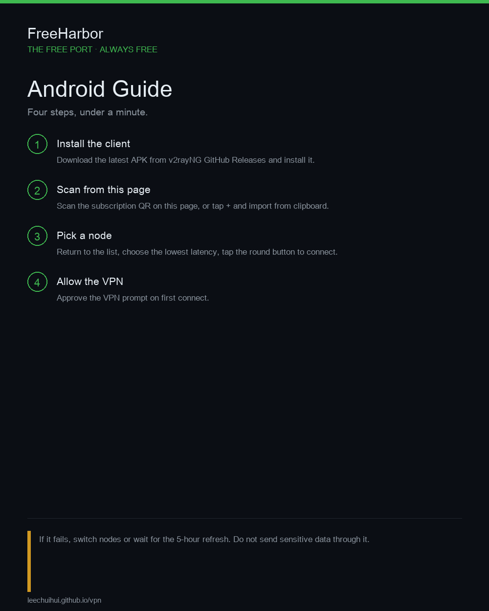
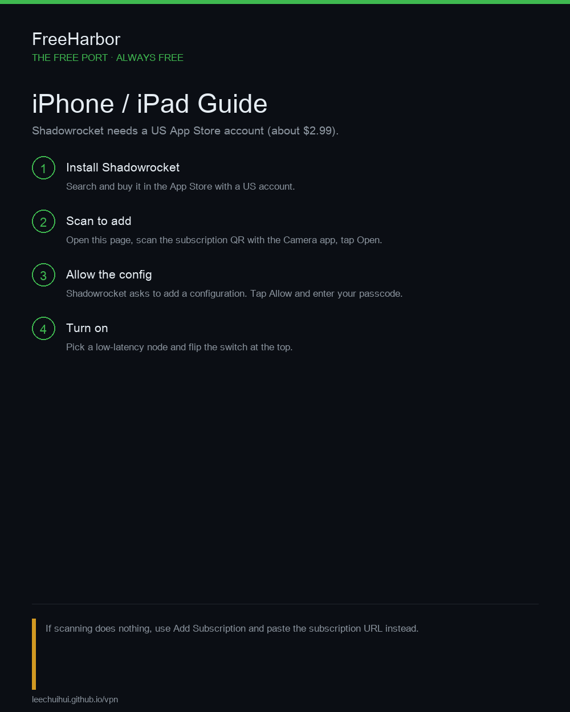
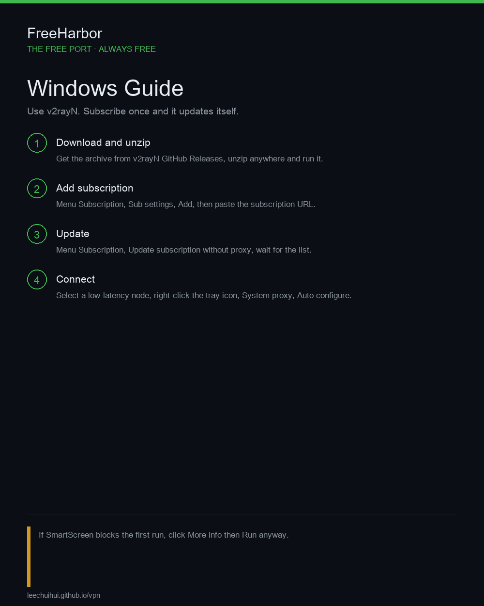
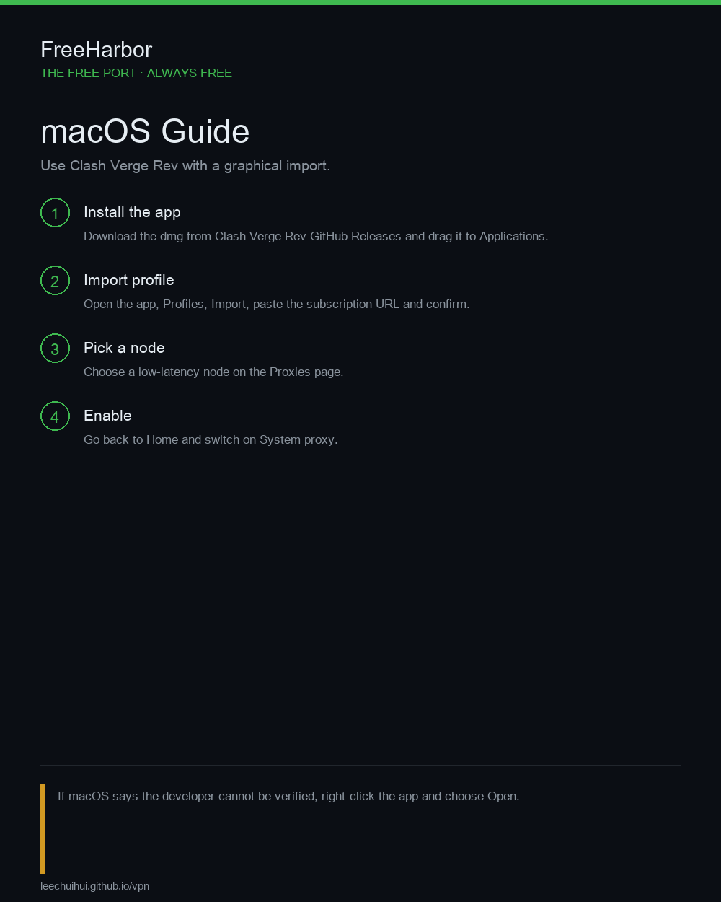

**English** | [简体中文](README.zh-CN.md)

# 🌊 FreeHarbor · The Free Port — Permanently Free VPN Node Subscriptions

[](https://leechuihui.github.io/FreeHarbor/)
[](https://github.com/Leechuihui/FreeHarbor/actions)
[](#tooling)
[](#notes)

**FreeHarbor / The Free Port** — a permanently free, auto-updating VPN node subscription site. Public free nodes are scraped, verified end-to-end through a real connection, sorted by latency, and published as subscriptions and QR codes. GitHub Actions refreshes everything every 3 hours at zero server cost.

**Live page:** https://leechuihui.github.io/FreeHarbor/

> First time only: set Settings → Pages → Source to **GitHub Actions**. Every later refresh publishes itself.

## One-tap subscription

```
https://raw.githubusercontent.com/Leechuihui/FreeHarbor/main/sub/all.txt
```

Base64 format (better compatibility with v2rayN / Shadowrocket):

```
https://raw.githubusercontent.com/Leechuihui/FreeHarbor/main/sub/all.base64.txt
```

Fastest 20 only:

```
https://raw.githubusercontent.com/Leechuihui/FreeHarbor/main/sub/best.txt
```

## Step-by-step guides

| Platform | Guide |
|---|---|
| Android |  |
| iPhone / iPad |  |
| Windows |  |
| macOS |  |

## Clients

| Platform | Client | How |
|---|---|---|
| Android | [v2rayNG](https://github.com/2dust/v2rayNG/releases/latest) | Scan / subscribe |
| Windows | [v2rayN](https://github.com/2dust/v2rayN/releases/latest) | Subscribe |
| iOS / macOS | [Shadowrocket](https://apps.apple.com/app/shadowrocket/id932747118) | Scan |
| Desktop GUI | [Clash Verge Rev](https://github.com/clash-verge-rev/clash-verge-rev/releases/latest) | Import [clash.yaml](clients/clash.yaml) |
| CLI, all platforms | [sing-box](https://github.com/SagerNet/sing-box/releases/latest) | Import [singbox.json](clients/singbox.json) |

## Current nodes

- Verified online: **50**
- Unverified (unsupported protocol / unreachable / over the quota): **150**
- Fastest latency: **44 ms**
- By protocol: trojan 24 · vless 103 · vmess 7 · ss 61 · hysteria2 5
- Updated: 2026-11-21 01:59:42 UTC

## Tooling

Five scripts on the Node standard library plus `qrcode`; guide images come from `tools/guides.py` (Pillow):

```bash
npm install
node tools/fetch.mjs      # scrape upstream sources from tools/sources.txt → data/raw/
node tools/parse.mjs      # parse, dedupe, drop private/broken → data/nodes.json
node tools/probe.mjs      # TCP reachability → data/checked.json
node tools/verify.mjs     # real egress check per node → data/verified.json
node tools/export.mjs     # subscriptions, QR codes, client configs, page, README
python3 tools/guides.py   # regenerate bilingual guide images → assets/
```

To add a source, append one URL per line to `tools/sources.txt`. Plain lists, base64 subscriptions and Clash YAML are all accepted.

## Notes

Nodes come from public free sources; stability is not guaranteed. A passed verification only means the node worked at that moment. Do not send sensitive data through them.

hysteria2 / tuic / ssr cannot be verified with xray, and Shadowsocks was removed entirely in xray 26. Those are kept as-is and sorted last.

## 🌟 Star History

If this project saved you time, consider giving it a star ⭐ — it helps others find free, verified nodes.

[](https://star-history.com/#Leechuihui/FreeHarbor&Date)

## 🔗 Related

- [v2rayNG](https://github.com/2dust/v2rayNG) · [v2rayN](https://github.com/2dust/v2rayN) — the clients this site's subscriptions are tested with
- [sing-box](https://github.com/SagerNet/sing-box) — universal proxy platform
- [Xray-core](https://github.com/XTLS/Xray-core) — the verification engine behind egress checks
