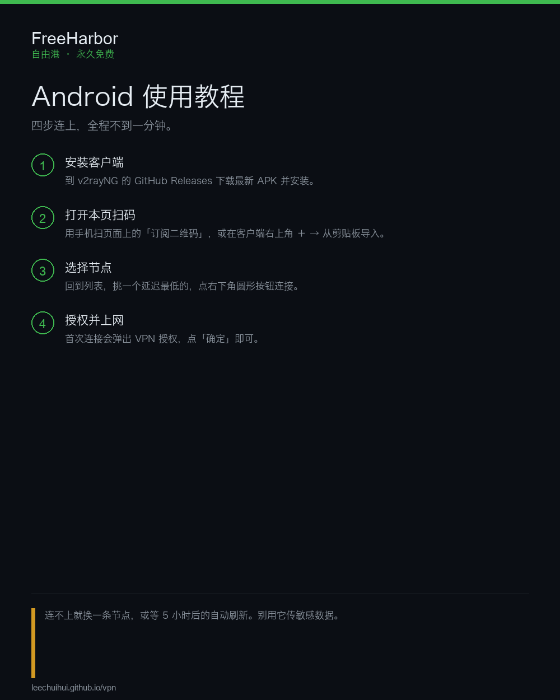
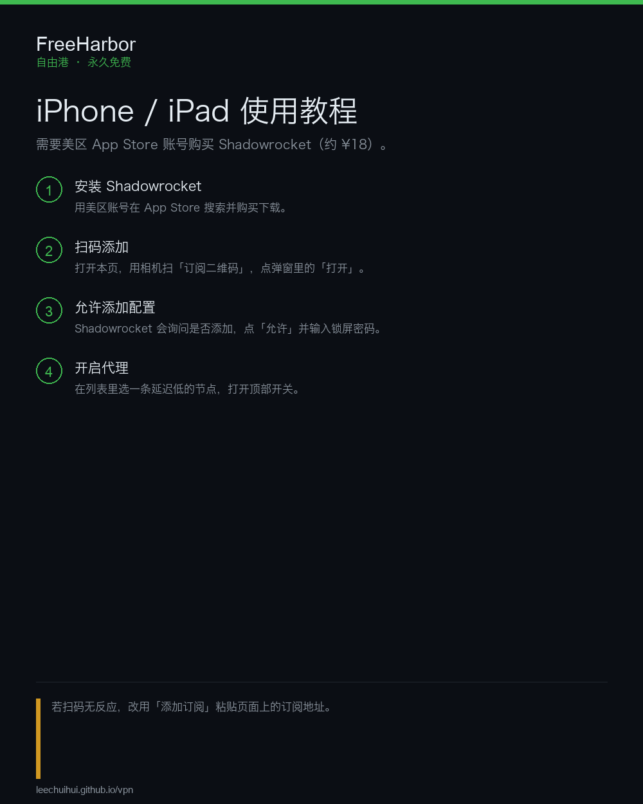
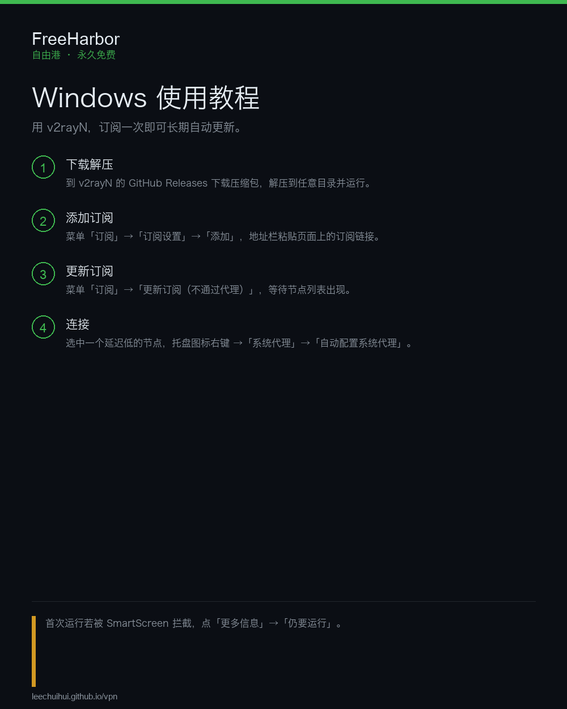
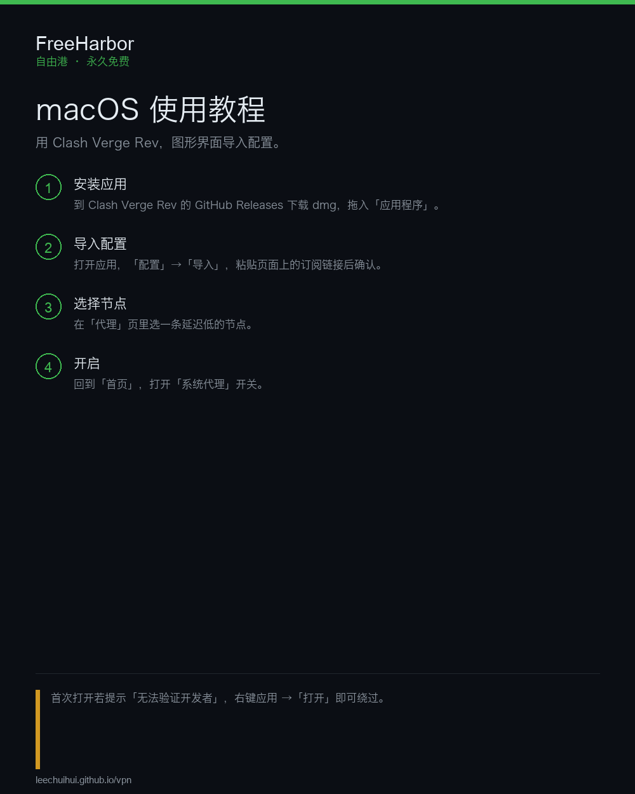

[English](README.md) | **简体中文**

# 🌊 FreeHarbor 自由港 · 永久免费 VPN 节点订阅

[](https://leechuihui.github.io/FreeHarbor/)
[](https://github.com/Leechuihui/FreeHarbor/actions)
[](#工具)
[](#说明)

**FreeHarbor / The Free Port** — 永久免费、自动更新的 VPN 节点订阅站。抓取公开免费节点，经真实出网验证后按延迟排序，生成订阅与二维码；每 3 小时由 GitHub Actions 自动刷新，零服务器成本。

**在线页面：** https://leechuihui.github.io/FreeHarbor/

> 首次使用需在仓库 Settings → Pages 里把 Source 设为 **GitHub Actions**，之后每次刷新会自动发布。

## 一键订阅

```
https://raw.githubusercontent.com/Leechuihui/FreeHarbor/main/sub/all.txt
```

base64 格式（v2rayN / Shadowrocket 兼容更好）：

```
https://raw.githubusercontent.com/Leechuihui/FreeHarbor/main/sub/all.base64.txt
```

只要最快的一批（前 20 条）：

```
https://raw.githubusercontent.com/Leechuihui/FreeHarbor/main/sub/best.txt
```

## 使用教程（图文）

| 平台 | 教程 |
|---|---|
| Android |  |
| iPhone / iPad |  |
| Windows |  |
| macOS |  |

## 客户端

| 平台 | 客户端 | 方式 |
|---|---|---|
| Android | [v2rayNG](https://github.com/2dust/v2rayNG/releases/latest) | 扫码 / 订阅 |
| Windows | [v2rayN](https://github.com/2dust/v2rayN/releases/latest) | 订阅 |
| iOS / macOS | [Shadowrocket](https://apps.apple.com/app/shadowrocket/id932747118) | 扫码 |
| 桌面 GUI | [Clash Verge Rev](https://github.com/clash-verge-rev/clash-verge-rev/releases/latest) | 导入 [clash.yaml](clients/clash.yaml) |
| 全平台 CLI | [sing-box](https://github.com/SagerNet/sing-box/releases/latest) | 导入 [singbox.json](clients/singbox.json) |

## 当前节点

- 已验证出网：**50**
- 未验证（协议不支持 / 连不通 / 超出验证名额）：**150**
- 最快延迟：**44 ms**
- 协议分布：trojan 24 · vless 103 · vmess 7 · ss 61 · hysteria2 5
- 更新时间：2026-11-21 01:59:42 UTC

## 工具

五个脚本，纯 Node 标准库 + `qrcode`；教程图由 `tools/guides.py`（Pillow）生成：

```bash
npm install
node tools/fetch.mjs      # 抓取 tools/sources.txt 里的上游源 → data/raw/
node tools/parse.mjs      # 解析、去重、过滤私网/坏端口 → data/nodes.json
node tools/probe.mjs      # TCP 探测存活 → data/checked.json
node tools/verify.mjs     # 经每个节点真实出网 → data/verified.json
node tools/export.mjs     # 生成订阅、二维码、客户端配置、页面、README
python3 tools/guides.py   # 重新生成双语教程图 → assets/
```

要加自己的源，往 `tools/sources.txt` 追加一行 URL 就行，支持明文列表、base64 订阅、Clash YAML 三种格式。

## 说明

节点来自公开免费源，稳定性不保证。通过验证只代表当下这一刻能出网。别拿它传敏感数据。

hysteria2 / tuic / ssr 无法用 xray 验证，Shadowsocks 则是 xray 26 起整个移除，这几类原样保留并排在末尾。

## 🌟 星标历史

如果这个项目为你节省了时间，欢迎点一个 Star ⭐ —— 这能让更多人找到免费、已验证的节点。

[](https://star-history.com/#Leechuihui/FreeHarbor&Date)

## 🔗 相关项目

- [v2rayNG](https://github.com/2dust/v2rayNG) · [v2rayN](https://github.com/2dust/v2rayN) — 本站订阅所测试使用的客户端
- [sing-box](https://github.com/SagerNet/sing-box) — 通用代理平台
- [Xray-core](https://github.com/XTLS/Xray-core) — 出网验证背后的验证引擎
